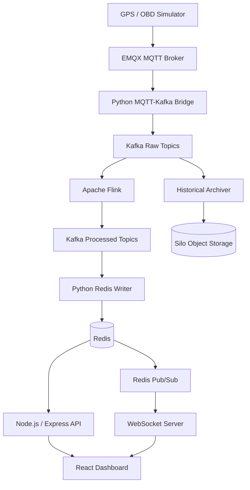

# FleetOps — Real-Time Fleet Tracking & Telemetry Platform

A real-time fleet monitoring platform that ingests GPS and vehicle diagnostics (OBD) telemetry, processes streaming events, maintains live vehicle state, and archives historical telemetry.

FleetOps demonstrates an event-driven architecture using MQTT, Apache Kafka, Apache Flink, Redis, Node.js, and React.

## 1. Overview

FleetOps simulates a fleet of connected trucks and processes their telemetry through a streaming pipeline.

The platform supports:

- Real-time GPS tracking and vehicle diagnostics.
- MQTT-based telemetry ingestion.
- Kafka-based event streaming.
- Stream validation using Apache Flink.
- Duplicate and stale-event detection.
- Redis-backed latest vehicle state.
- Live dashboard updates using WebSockets.
- Historical telemetry archiving in compressed JSONL format.
- Online/offline vehicle detection.
- Paginated fleet retrieval through REST APIs.

The current development demo has been tested with 100 simulated trucks.

## 2. Architecture



### Telemetry lifecycle

1. **Simulation:** The Python simulator generates GPS and OBD readings for individual trucks.
2. **Ingestion:** Readings are published to EMQX using MQTT.
3. **Bridging:** A Python bridge validates incoming messages and forwards them to Kafka.
4. **Stream processing:** Flink SQL jobs validate GPS and OBD records and forward accepted events.
5. **State management:** The Redis writer performs duplicate and stale-event checks and updates the latest truck state.
6. **Live delivery:** Accepted updates are published through Redis Pub/Sub and delivered to connected dashboard clients using WebSockets.
7. **Historical storage:** A separate archiver consumes raw Kafka telemetry and stores compressed historical data in Silo.

## 3. Technology Stack

| Component           | Technology                   | Responsibility                         |
| ------------------- | ---------------------------- | -------------------------------------- |
| Telemetry simulator | Python                       | Generates GPS and OBD readings         |
| MQTT broker         | EMQX 5.8                     | Device telemetry ingestion             |
| Event streaming     | Apache Kafka 4.1             | Durable event transport                |
| Stream processing   | Apache Flink 1.20            | Telemetry validation                   |
| State store         | Redis 7.4                    | Latest vehicle state and deduplication |
| Backend API         | Node.js, Express, TypeScript | REST APIs and WebSockets               |
| Frontend            | React 19, TypeScript         | Fleet monitoring dashboard             |
| Mapping             | Leaflet, React-Leaflet       | Live vehicle locations                 |
| Historical storage  | Silo (S3-compatible)         | Compressed telemetry archives          |

## 4. Key Engineering Features

### MQTT-to-Kafka bridge

The bridge connects EMQX to Kafka and handles:

- MQTT persistent sessions.
- Manual MQTT acknowledgements.
- Kafka delivery confirmation before acknowledging MQTT messages.
- Retry and delivery handling.
- Telemetry metadata and range validation.
- Invalid-message routing to a dead-letter topic.

This prevents the bridge from acknowledging a message before Kafka has confirmed its delivery.

### Stream processing with Flink

GPS and OBD streams are processed independently.

The Flink SQL jobs perform basic validation of:

- Truck and device identifiers.
- Boot/session identifiers.
- Sequence numbers.
- Event timestamps.
- Schema versions.
- GPS coordinates and speed.
- Engine RPM, fuel level, temperature and battery voltage.

Invalid records are filtered out by the processing jobs.

### Duplicate and stale-event protection

The Redis writer uses a Lua script to execute state updates atomically.

It checks:

1. Whether an event ID has already been processed.
2. Whether the incoming sequence number is older than the latest accepted sequence.
3. Whether a message belongs to a new device boot session.
4. Whether a new session's event timestamp is newer than the stored event.

Accepted events update the corresponding GPS or OBD state.

Event IDs are retained for seven days to prevent duplicate processing.

### Redis-backed live state

Redis stores the latest GPS and OBD information independently for each truck.

Example key structure:

- `truck:<truckId>` — latest truck state.
- `event:seen:<eventId>` — duplicate-event tracking.
- `truck-updates` — Redis Pub/Sub channel for accepted updates.

Redis persistence is configured using Append-Only File (AOF).

### Live dashboard

The React dashboard provides:

- Fleet-wide vehicle visibility.
- Online and offline status.
- GPS location markers.
- Searchable truck listings.
- GPS and OBD details.
- Expandable truck information within the fleet table.
- Automatic online-first sorting.
- Live updates without browser refreshes.

Vehicle status is calculated using the freshness of the latest GPS or OBD timestamp.

### Historical telemetry archiving

The historical archiver consumes the raw Kafka topics independently of the live processing pipeline.

It writes compressed JSON Lines (`.jsonl.gz`) objects to Silo.

Separate storage buckets are used:

- `gps-history`
- `obd-history`

Objects use deterministic partition and offset-based names to support safe retries.

The archiver uploads batches before committing their Kafka offsets.

## 5. Kafka Topics

| Topic           | Purpose                                 |
| --------------- | --------------------------------------- |
| `gps-telemetry` | Raw GPS events                          |
| `obd-telemetry` | Raw OBD events                          |
| `gps-latest`    | Validated GPS events                    |
| `obd-processed` | Validated OBD events                    |
| `telemetry-dlq` | Invalid messages received by the bridge |

The development Kafka broker is configured with 12 partitions and a replication factor of 1.

## 6. Project Structure

```text
fleet-tracking-system/
│
├── backend/
│   ├── history_archiver.py
│   ├── redis_writer.py
│   ├── replay_duplicate.py
│   ├── replay_stale.py
│   ├── test_invalid_obd.py
│   └── test_invalid_telemetry.py
│
├── backend-api/
│   ├── src/
│   │   └── server.ts
│   ├── package.json
│   └── tsconfig.json
│
├── frontend/
│   ├── src/
│   │   ├── App.tsx
│   │   ├── App.css
│   │   ├── index.css
│   │   └── main.tsx
│   └── package.json
│
├── simulator/
│   ├── gps_simulator.py
│   ├── mqtt_kafka_bridge.py
│   ├── mqtt_subscriber.py
│   └── requirements.txt
│
├── flink/
│   └── lib/
│       └── flink-sql-connector-kafka-3.4.0-1.20.jar
│
├── infrastructure/
│   └── docker-compose.yml
│
├── docs/
│
├── .gitignore
└── README.md
```

## 7. Local Setup

### Prerequisites

- Docker Desktop with Docker Compose.
- Python 3.10 or later.
- Node.js 22 or later.
- npm.

### Step 1: Clone the repository

```bash
git clone https://github.com/aiyer786/fleet-tracking-system.git
cd fleet-tracking-system
```

### Step 2: Start infrastructure

```bash
docker compose -f infrastructure/docker-compose.yml up -d
```

The following services will be available:

| Service         | Local address            |
| --------------- | ------------------------ |
| Kafka           | `localhost:9092`         |
| EMQX MQTT       | `localhost:1883`         |
| EMQX Dashboard  | `http://localhost:18083` |
| Redis           | `localhost:6379`         |
| Flink Dashboard | `http://localhost:8081`  |
| Silo API        | `http://localhost:9000`  |
| Silo Console    | `http://localhost:9001`  |

These are local development configurations, not production security settings.

### Step 3: Install Python dependencies

```bash
pip install -r simulator/requirements.txt
```

The Python services also require their respective Kafka, Redis and S3-compatible storage client libraries. Ensure these dependencies are included in the requirements file before running the complete pipeline.

### Step 4: Install backend dependencies

```bash
cd backend-api
npm install
cd ..
```

### Step 5: Install frontend dependencies

```bash
cd frontend
npm install
cd ..
```

### Step 6: Start Flink processing

Open the Flink dashboard:

`http://localhost:8081`

Submit the GPS and OBD Flink SQL jobs through the Flink SQL client.

Both jobs must be running before starting the complete telemetry pipeline.

The Kafka SQL connector is mounted into the Flink containers through Docker Compose.

### Step 7: Start the MQTT-to-Kafka bridge

From the project root:

```bash
python simulator/mqtt_kafka_bridge.py
```

### Step 8: Start the Redis writer

Open another terminal:

```bash
python backend/redis_writer.py
```

### Step 9: Start the historical archiver

Open another terminal:

```bash
python backend/history_archiver.py
```

Configure the Silo endpoint and credentials through environment variables before starting the archiver.

### Step 10: Start the backend API

```bash
cd backend-api
npm run dev
```

The API runs at:

`http://localhost:3000`

### Step 11: Start the frontend

Open another terminal:

```bash
cd frontend
npm run dev
```

Open the Vite development URL displayed in the terminal.

### Step 12: Start telemetry simulation

From the project root:

```bash
python simulator/gps_simulator.py --trucks 10
```

The dashboard should begin displaying the simulated fleet.

## 8. API Overview

### Get fleet data

```http
GET /api/trucks
```

Supports pagination using `limit` and `cursor` query parameters.

Example:

```http
GET /api/trucks?limit=100&cursor=0
```

Response structure:

```json
{
  "trucks": [],
  "nextCursor": "672",
  "hasMore": true
}
```

### Get an individual truck

```http
GET /api/trucks/:truckId
```

Returns the latest stored state for the requested truck.

### WebSocket updates

The backend exposes a WebSocket connection on port `3000`.

Accepted GPS and OBD updates are broadcast to connected clients through Redis Pub/Sub.

## 9. Testing and Validation

The development pipeline has been exercised using simulated telemetry.

| Test                           | Result   |
| ------------------------------ | -------- |
| GPS and OBD ingestion          | Verified |
| MQTT-to-Kafka delivery         | Verified |
| Flink GPS/OBD processing       | Verified |
| Invalid telemetry handling     | Tested   |
| Duplicate-event rejection      | Tested   |
| Stale sequence rejection       | Tested   |
| Redis state updates            | Verified |
| REST fleet pagination          | Verified |
| WebSocket live updates         | Verified |
| Online/offline transitions     | Verified |
| Backend restart recovery       | Verified |
| Redis persistence and recovery | Verified |
| Historical GPS/OBD archiving   | Verified |

The live demo was tested with 10 simulated trucks, including stopping and restarting the simulator to verify offline detection and recovery.

These tests demonstrate functional behaviour in a local development environment. They are not a production-scale throughput or availability benchmark.

## 10. Scalability and Reliability Considerations

The architecture separates ingestion, stream processing, state management, API delivery and historical storage.

This allows individual components to scale independently.

Potential production improvements include:

- Multiple MQTT bridge instances using shared subscriptions.
- Kafka partition and consumer-group tuning.
- Multiple Flink TaskManagers and appropriate checkpointing.
- Redis clustering or sharding for larger fleets.
- Batch-based Kafka offset commits.
- Dedicated API instances behind a load balancer.
- Database-backed historical querying and analytics.
- Stronger device identity and session management.
- Authentication, authorization and encrypted service communication.
- Monitoring, metrics, alerting and distributed tracing.

The current Docker Compose deployment is a single-node development environment. High availability and large-scale throughput have not been benchmarked.

## 11. Known Limitations

- Device simulation is used instead of physical vehicle hardware.
- Kafka is configured as a single broker with replication factor 1.
- Redis is deployed as a single instance.
- Flink processing is limited to basic validation.
- Stateful duplicate and stale-event detection is performed by the Redis writer.
- Device session ordering currently relies on event timestamps when a new boot ID appears; production deployments should use a trusted session epoch or boot counter.
- The local setup uses development credentials and does not represent a production security configuration.
- The current project has not been benchmarked at 100,000 concurrent trucks.

## 12. Future Improvements

- Automated deployment of Flink SQL jobs.
- Automated integration and load testing.
- Device authentication and secure MQTT connections.
- Historical telemetry query and playback.
- Fleet analytics and operational reporting.
- Multi-tenant access controls.
- Production-grade observability and alerting.
- High-availability infrastructure deployment.

---

**FleetOps** is an engineering demonstration of an end-to-end streaming telemetry platform, combining event-driven ingestion, stream validation, stateful processing, live updates and historical storage.
